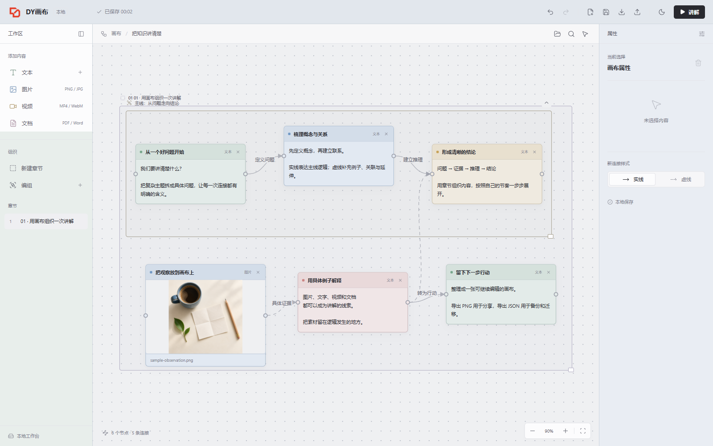
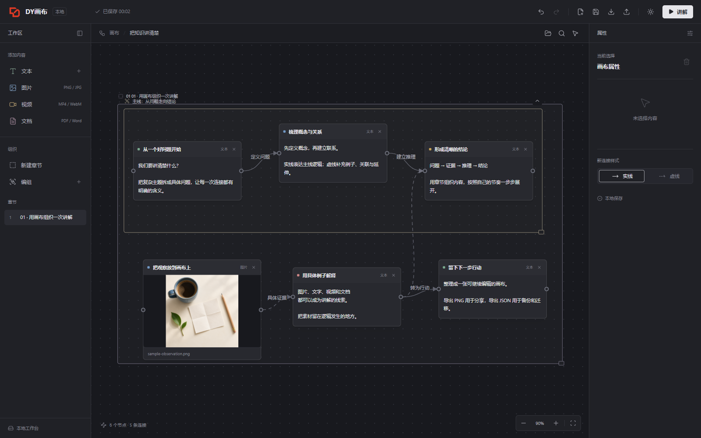
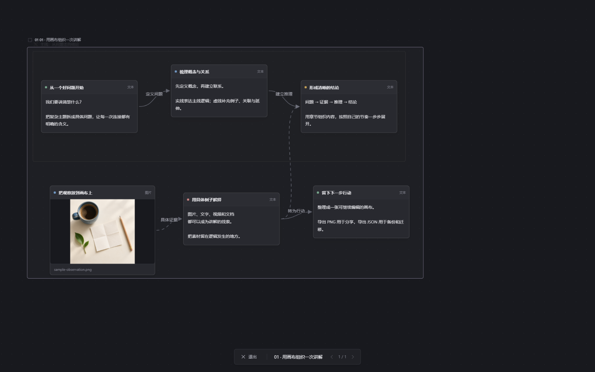

<p align="center">
  
</p>

# DY画布

**用于本地讲解演示与知识逻辑梳理的无限画布。**

把文字、图片、视频和文档放到同一张画布，用节点、连接线、编组和章节组织思路。支持 Windows 桌面安装和浏览器直接运行，内容保存在本地。

[Windows 下载](https://github.com/jyan5334-lab/dy-canvas/releases/latest) · [使用手册](docs/user-guide.md) · [版本记录](CHANGELOG.md) · [问题反馈](https://github.com/jyan5334-lab/dy-canvas/issues)

## 界面预览

### 白天模式



### 夜晚模式



### 讲解模式



以上截图来自实际运行的应用，使用演示内容，不包含个人画布数据。

## 主要功能

| 能力 | 说明 |
| --- | --- |
| 内容节点 | 文字、图片、视频、文档；支持粘贴图片和拖入本地文件 |
| 直接编辑 | 节点标题双击编辑，正文可直接输入，并与右侧属性同步 |
| 节点尺寸 | 四角和四边拖动调整大小；文字自动换行并随内容增长高度 |
| 逻辑连接 | 拖动输出点连接输入点，柔性曲线预览；每条线独立保留实线或虚线样式 |
| 连接编辑 | 设置连接说明、修改单条连线样式、删除连线 |
| 编组整理 | Shift 框选节点，编组、命名、移动、折叠与展开 |
| 章节讲解 | 按章节导航，可设置节点逐步显示顺序及讲解备注 |
| 画布库 | 多画布切换、命名、归档和恢复；保留最近 10 个历史快照 |
| 搜索与撤销 | 搜索内容并跳转；支持撤销、重做 |
| 导出与备份 | PNG 图片导出、JSON 导入导出、原始附件下载 |
| 两套主题 | 白天 / 夜晚模式，点阵背景保持固定点大小 |

本项目专注于本地讲解、演示与知识整理，不包含图片生成、视频生成或云端协作服务。

## 快速开始

### Windows 桌面版

1. 从 [Releases](https://github.com/jyan5334-lab/dy-canvas/releases) 下载 `DYCanvas-Setup-1.0.1-x64.exe`。
2. 在 Windows 10 / 11 的 64 位 x64 系统运行安装包。
3. 从桌面或开始菜单打开「DY画布」。

安装后的应用可离线使用，无需另装 Node.js 或启动服务器。当前安装包未做数字签名。

### 浏览器版

下载源码后，直接打开 `index.html`。也可以安装 Node.js 后在项目根目录运行：

```sh
node serve.cjs
```

在浏览器访问 `http://localhost:4173`。使用固定浏览器和地址，才能继续访问对应的本地数据。

### 从源码构建 Windows 安装包

在 Windows 上使用支持本项目依赖的 Node.js 版本。已验证环境为 Node.js 24；首次安装和构建工具下载需要网络。

```sh
git clone https://github.com/jyan5334-lab/dy-canvas.git
cd dy-canvas
npm ci
npm run dist:win
```

安装包输出到 `release/`。开发运行使用 `npm start`，仅生成解包后的桌面程序使用 `npm run pack:win`。

## 常用操作

- 双击画布空白处：选择并添加内容。
- 左键拖动画布空白处：移动视野；滚轮缩放。
- 按住输出点并拖到输入点：建立连接；松到空白处取消。
- Shift + 左键拖动：框选节点，再进行编组。
- 双击节点标题：编辑名称；直接点击节点正文：编辑文字。
- Ctrl+F：搜索；Ctrl+Z：撤销；Ctrl+Shift+Z / Ctrl+Y：重做。
- 点击「讲解」：进入章节演示；Esc 退出。

完整操作、文档预览和章节顺序说明见 [使用手册](docs/user-guide.md)。

## 数据与备份

- 桌面数据保存在 `%APPDATA%\WirelessCanvas`，与程序安装目录分开；升级沿用此目录，卸载默认保留数据。
- 浏览器版使用本地数据库。桌面版和浏览器版的数据独立，可通过 JSON 导出、导入迁移。
- 图片、视频和文档附件保存在画布数据中，不上传云端。重要内容请定期导出 JSON 备份；PNG 用于分享，JSON 用于继续编辑和恢复。
- 清除浏览器站点数据、删除应用数据目录会影响本地画布。源码仓库不包含使用者的画布或个人附件。

## 代码结构

```text
app.js                    节点、交互、连接、编组与章节
workspace-features.js     画布库、历史版本、搜索和附件预览
index.html / style.css    应用界面与主题
desktop/                  Electron 主进程、预加载、图标与 Windows 构建
media/                    应用 Logo 和演示素材
vendor/                   随程序分发的前端依赖与许可证
docs/                     使用手册与实际运行截图
serve.cjs                 可选的本地静态服务器
```

依赖版本由 `package-lock.json` 锁定。仓库排除了依赖目录、生成的安装包、个人画布数据和凭据文件。

## 反馈与许可

反馈问题时，请附上系统版本、应用版本、复现步骤和相关截图，并避免提交个人画布或敏感附件。

代码公开展示，当前未指定开源许可证，`package.json` 标记为 `UNLICENSED`。第三方组件的许可证见 [THIRD_PARTY_NOTICES.md](THIRD_PARTY_NOTICES.md) 及 `vendor/` 中的许可文件。
